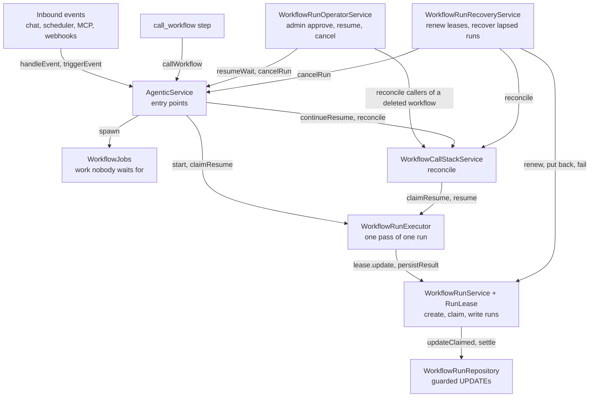
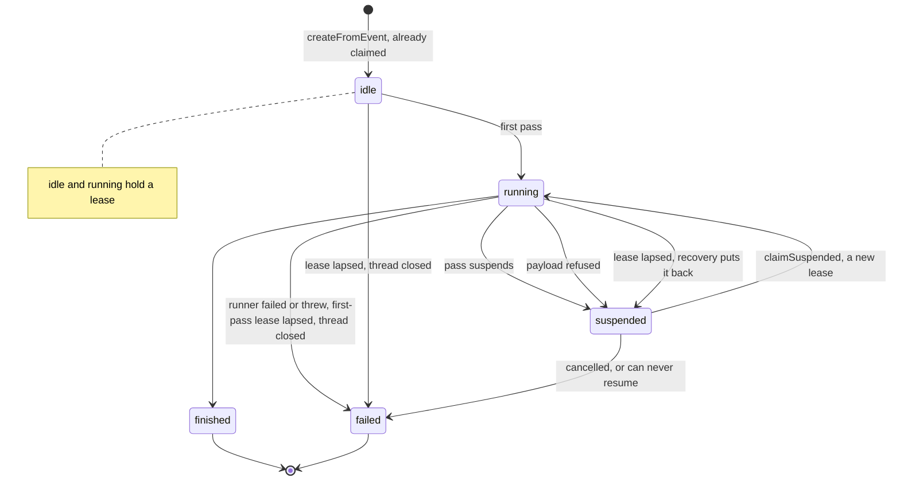
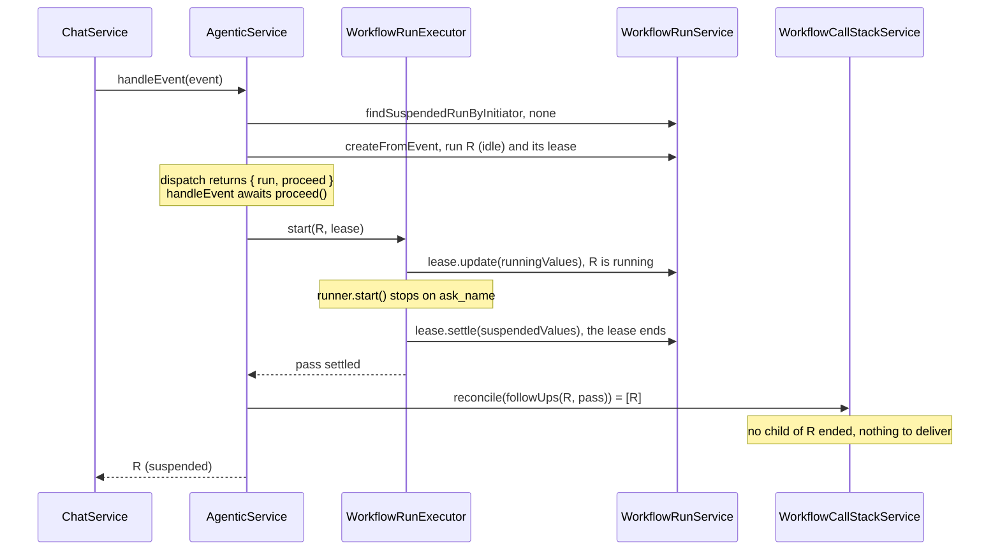
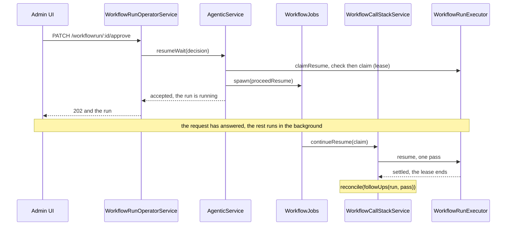
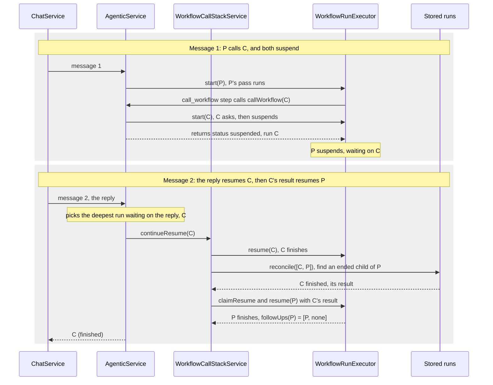
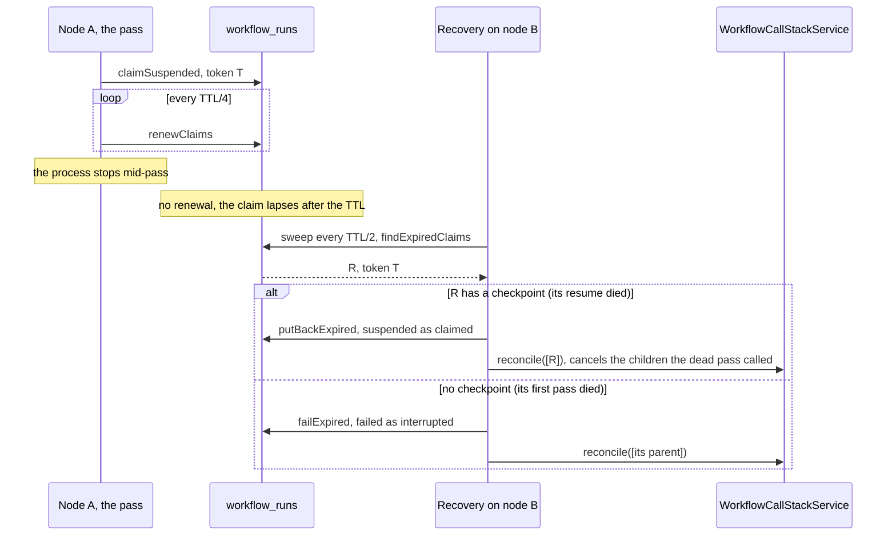

# Workflow runs

This module stores workflows and runs them with the `@hexabot-ai/agentic`
runner. This README explains how a run executes, stops to wait for something,
resumes, and carries results up a chain of workflows that call each other,
with five end-to-end examples.

Two other documents complete it:

- [`packages/api/AGENTS.md`](../../AGENTS.md), section "Workflow runs and
  suspension": the rules that must stay true, in short form. Change them
  together with the code.
- [`packages/agentic/SUSPENSION.md`](../../../agentic/SUSPENSION.md), section
  8: the runner's side of the contract (checkpoints, waits, refusals).

Paths below are relative to this folder, `packages/api/src/workflow`.

## Words used here

- **Run**: one execution of a workflow, stored as a row in `workflow_runs`. A
  run can live across many requests and many days.
- **Pass**: one stretch of execution of a run, from the moment the runner
  starts or resumes it until it stops again: it suspends, finishes, fails or
  crashes. A run that asks the user two questions takes three passes.
- **Wait**: a point where a run stopped for something from outside: a chat
  reply, an admin decision, or the result of a workflow it called. A
  suspended run has one or more open waits.
- **Checkpoint**: the JSON column that holds everything needed to resume a
  suspended run. `suspended_at` versions it, so two callers can never resume
  the same suspension.
- **Lease** (`RunLease`): the claim this process holds on a run while it
  works on it. Only the holder of a run's lease can write the run.

## Four rules

1. **A run is written only by whoever holds its lease.** Starting or resuming
   a run takes a lease, a claim token stored on the row. Every write checks
   that token (`claim_id = :claimId`), so a pass whose run was taken over or
   recovered cannot overwrite it. While a lease is held, this process renews
   it; if the process dies, the lease lapses and recovery takes the run over.
2. **A pass ends in one of four ways, and says which** (`RunPass`):
   `settled` (the runner's result was written), `rejected` (a step refused
   the resume payload, and the run is back on the same wait), `crashed` (the
   runner threw, and the run was failed) or `claim_lost` (someone else
   settled the run meanwhile, and this pass's outcome was dropped).
3. **After every pass, look at what it left** (`followUps`). A run back to
   `suspended` is checked for child runs that ended meanwhile; a run that
   ended is checked, and so is its parent. That check is `reconcile`, and it
   is the only way a child's result reaches its parent. It also cancels the
   called runs nothing waits on any more (example 4).
4. **Callers choose whether to wait.** Every entry point first claims or
   creates the run, then either waits for the work left on it (chat,
   scheduler, MCP, synchronous webhooks), or hands that work to
   `WorkflowJobs` and answers right away (the admin UI, manual runs, webhooks
   with `?async=true`).

## The parts

Each layer calls only the layers below it.

| Part                             | File                                                                                                           | What it owns                                                                                                                                                                                        |
| -------------------------------- | -------------------------------------------------------------------------------------------------------------- | --------------------------------------------------------------------------------------------------------------------------------------------------------------------------------------------------- |
| `AgenticService`                 | [`services/agentic.service.ts`](services/agentic.service.ts)                                                   | The entry points. Finds or creates the run, claims it, then waits for the rest or hands it to `WorkflowJobs`.                                                                                       |
| `WorkflowJobs`                   | [`services/workflow-jobs.service.ts`](services/workflow-jobs.service.ts)                                       | Work no caller waits for: logs its errors and tracks it, so tests can wait for it (`onIdle`) and a shutdown can let it finish.                                                                      |
| `WorkflowCallStackService`       | [`services/workflow-call-stack.service.ts`](services/workflow-call-stack.service.ts)                           | `reconcile`: cancels the called runs nothing waits on any more, and resumes a suspended run with the result of a child run that ended. `continueResume`: a claimed resume's pass, then `reconcile`. |
| `WorkflowRunExecutor`            | [`services/workflow-run-executor.service.ts`](services/workflow-run-executor.service.ts)                       | One pass of one run: checks and claims a run for a resume, runs the runner, writes how the pass ended. Knows nothing of parents or children.                                                        |
| `WorkflowRunService`, `RunLease` | [`services/workflow-run.service.ts`](services/workflow-run.service.ts), [`lib/run-lease.ts`](lib/run-lease.ts) | Creates and claims runs and hands out a lease per claim. `lease.update` keeps the claim, `lease.settle` writes the end of a pass and gives it back, `lease.end` gives it up.                        |
| `WorkflowRunRepository`          | [`repositories/workflow-run.repository.ts`](repositories/workflow-run.repository.ts)                           | The SQL. Every write of a claimed run is an `UPDATE … WHERE claim_id = :token`.                                                                                                                     |
| `WorkflowRunRecoveryService`     | [`services/workflow-run-recovery.service.ts`](services/workflow-run-recovery.service.ts)                       | Renews the leases this process holds, and recovers runs whose lease lapsed (example 5).                                                                                                             |
| `WorkflowRunOperatorService`     | [`services/workflow-run-operator.service.ts`](services/workflow-run-operator.service.ts)                       | The admin endpoints (example 3), and the call stacks around a deleted workflow.                                                                                                                     |
| `WorkflowCompiler`               | [`services/workflow-compiler.service.ts`](services/workflow-compiler.service.ts)                               | Compiles the definition a run pinned.                                                                                                                                                               |
| `WorkflowEventRestorer`          | [`services/workflow-event-restorer.service.ts`](services/workflow-event-restorer.service.ts)                   | Rebuilds a run's trigger event when no inbound event carries the resume (an admin decision, a child's result, recovery).                                                                            |

The outcome types the services share (`RunPass`, `ClaimedResume`,
`ResumeRefusal`, `ResumeWaitOutcome`, `CancelRunOutcome`) live in `types.ts`.
Pure helpers live in `lib/`: `lib/workflow-call-stack.ts` for parent/child
linkage (`followUps`, `getChildRunId`, the `call_workflow` payloads),
`lib/run-lease.ts` for leases and the values each status writes,
`lib/workflow-run-waits.ts` for reading open waits.

## The life of a run

- **idle**: just created by `createFromEvent`, already claimed in the same
  insert (`WorkflowRunRepository.createClaimed`). No run is ever active
  without a lease, even if the process stops right after the insert.
- **running**: the first pass marked it with `lease.update(runningValues(…))`,
  or a resume claimed it with `claimSuspended`. A claim writes only the status
  and the token, so the run can always be put back exactly as it was.
- **suspended**: a pass ended on open waits. `suspendedValues` writes the
  checkpoint and a new `suspended_at`, and sets `awaiting_operator` when an
  admin must decide. No lease is held.
- **finished**, **failed**: final. `finishedValues` and `failedValues` clear
  the checkpoint.

Every change of status is a write through the run's lease (`lease.settle`),
except two: recovery writes with `recoverExpired`, which first checks that
the lease really lapsed, and closing a thread fails its runs without any
token, taking them over from whatever pass held them.

## Example 1: a chat message starts a run

A user writes "Hi" in a new conversation. The workflow greets them, then asks
for their name: that step suspends the run on a wait called `ask_name`.

1. `ChatService` calls `AgenticService.handleEvent`, the entry point that
   waits for the run.
2. `dispatch` looks for a suspended run of this user in this thread
   (`WorkflowRunService.findSuspendedRunByInitiator`). There is none, so it
   picks the workflow and creates a run.
3. `createFromEvent` inserts the run already claimed, as `idle`, and returns
   it with its lease. From now on this process renews the lease every TTL/4,
   until the lease ends.
4. `dispatch` runs nothing itself: it returns `{ run, proceed }`, and
   `handleEvent` calls `proceed()` because its caller waits. `triggerEvent`
   with `wait: false` would instead give `proceed` to `WorkflowJobs` and
   answer at once with the `idle` run.
5. `WorkflowRunExecutor.start` compiles the definition, builds the context
   and the runner, marks the run `running` through the lease, and starts the
   runner. All of it happens inside `runPass`, which writes how the pass ended
   and ends the lease however the pass ends.
6. The runner stops on `ask_name` and returns a `suspended` result with a
   checkpoint. `WorkflowRunService.persistResult` writes it with
   `lease.settle(suspendedValues(…))`, which ends the lease.
7. `followUps` says the run itself is to be reconciled, since it is
   suspended. `reconcile` finds no child run to cancel or deliver.
8. `handleEvent` returns the run, now `suspended`.

## Example 2: the reply resumes it

Run R is suspended on `ask_name`, and the user replies "Ada".

1. `ChatService` calls `handleEvent` again. `dispatch` finds R with
   `findSuspendedRunByInitiator`, which picks the deepest suspended run of
   this user in this thread with a wait the event resolves (step 2).
2. The event resolves the first open wait that the host does not resolve
   itself. Child results and admin decisions are resolved by the host
   (`HOST_RESOLVED_WAIT_REASONS` in `types.ts`), so a chat message never
   answers them. Here the wait is `ask_name`.
3. **Check before claiming.** `WorkflowRunExecutor.claimResume` compiles the
   definition the run pinned, validates the checkpoint, then validates the
   payload against what the wait accepts. Nothing is written yet, so a wrong
   payload changes nothing.
4. **Claim.** `WorkflowRunService.claimSuspended` runs one guarded `UPDATE …
WHERE status = 'suspended' AND suspended_at = <the loaded value>`. Only one
   caller wins a given suspension: when two replies arrive together, the
   second gets `claim_lost` and leaves the run alone. The winner gets a
   `RunLease`, renewed from this moment on.
5. **Pass.** `handleEvent` calls `proceed`, which runs
   `WorkflowCallStackService.continueResume`, which runs
   `WorkflowRunExecutor.resume`. The runner is rebuilt from the checkpoint and
   resumed with "Ada"; this time the workflow finishes, and `persistResult`
   writes `finishedValues` through the lease.
6. **Follow-ups.** R finished, so `followUps` names its parent. R has none,
   and `handleEvent` returns R, now `finished`.

**A refused payload.** Say the step expects a number and gets "Ada". It can
be refused in two places:

- **Before the claim.** A wait declares the payload it accepts
  (`suspend({ accepts })`), and `claimResume` checks it in step 3. The
  outcome is `rejected`, nothing is written, and
  `hook:workflow:resume_rejected` is emitted.
- **During the pass.** The step itself refuses it. The wait's JSON Schema is
  relaxed, so it lets through what only the step's Zod schema checks (a
  regex, a format, a refinement), and an action may refuse a payload no
  schema can judge (an unknown order id). The runner puts the run back as its
  checkpoint describes it and reports a `rejection`; `runPass` settles the
  lease with `putBackValues()`, which only sets the status back to
  `suspended`. The pass ends `rejected`, and `proceedResume` returns the
  refusal with the run.

Either way the run still waits on the same question.

Who hears about a refusal depends on the entry point. No one answers a chat
message, so `handleEvent` returns the run as it is. The triggers that answer
their caller (webhooks, manual runs from the admin, the MCP run tool) go
through `triggerEvent` instead, which returns `rejected`
(`TriggerEventOutcome`), or `claim_lost` when another caller claimed the run
first. `WebhookTriggerService.dispatchTriggerEvent` answers them `422`
(`payload_rejected`, with `issues` and `runId`) and `409` (`claim_lost`),
like the operator endpoints. A refusal during the pass reaches only the
callers that wait for the pass (synchronous webhooks, the MCP run tool); the
others answered once the run was claimed, and see the run go back to
`suspended` in its updates. Such a caller gets `claim_lost` too when the run
was taken over or recovered while the pass ran: `proceedResume` returns the
run with `claimLost`, since the outcome of the pass was dropped. A webhook call without authentication never
reaches a suspended run at all: it acts as the workflow's creator, so it
passes `resume: false` and always starts a new run.

## Example 3: an admin approves

A workflow reached an `await_approval` step, so its run is suspended on an
operator wait and appears in the admin's pending list. The admin clicks
Approve. The rest of the run can take minutes (an LLM call, a chain of called
workflows), and a proxy in front of the API answers `504` after 60 s, so the
request must not wait for it.

1. `WorkflowRunOperatorService.decide` builds the payload from the logged-in
   admin (who decided, and when), so a client can never forge it, and
   rebuilds the run's trigger event with `WorkflowEventRestorer`.
2. `AgenticService.resumeWait` checks and claims the run exactly as a chat
   reply does (`claimResume`, example 2). A refused payload is answered `422`
   (`payload_rejected`); a run another request claimed first, `409`
   (`claim_lost`).
3. Once the run is claimed, `resumeWait` hands the rest to
   `WorkflowJobs.spawn` before it reads the run back, so the reply reports
   how far the pass already got, usually `running`. The endpoint answers
   `202` with that run.
4. In the background, `proceedResume` runs `continueResume`: the pass, then
   `reconcile` of whatever it left. `WorkflowJobs` logs errors. Every write
   emits `hook:workflowRun:postUpdate`, which the admin UI follows live.

Cancelling (`cancelRun`) works the same way: the run and its suspended
descendants are failed inside the request, and its parent receives the
failed result in the background. The
endpoints and their errors are listed in
[`../extensions/actions/workflow/README.md`](../extensions/actions/workflow/README.md).

## Example 4: a workflow calls another

Workflow "Order" has a `call_workflow` step that calls workflow "Address",
which asks the user for their address. The user starts "Order" (run P); P
calls "Address" (run C); C asks its question. Later the user answers, C
finishes, and P must go on with C's result.

**Message 1: P calls C.**

1. P's first pass runs as in example 1 until it reaches the `call_workflow`
   step, which calls back into the API: `AgenticService.callWorkflow`
   ([`../extensions/actions/workflow/call-workflow.action.ts`](../extensions/actions/workflow/call-workflow.action.ts)).
2. `callWorkflow` checks the call (same workflow type, no cycle, a stack no
   more than 10 deep), creates C with P as its parent, and runs C's first
   pass right there, while P's pass waits. C asks its question and suspends.
3. `callWorkflow` returns `{ status: 'suspended', workflow_run_id: C }` to the
   step, which suspends P on a wait whose reason is `awaiting_child_workflow`
   and whose data names C. P is suspended too.

**Message 2: the reply resumes C, and C's result resumes P.**

1. The reply goes to the deepest suspended run of the conversation with a
   wait it resolves: C, not P. P's only wait is on a child, and inbound
   events never answer those.
2. C is resumed as in example 2 and finishes. `followUps` says: C ended, so
   look at C, whose own calls nothing waits on any more, then at its parent,
   P. C called nothing, so nothing is cancelled.
3. `reconcile` loads P. P is suspended, so `findEndedChild` goes through
   P's open waits in flow order and finds the wait on C, whose run is
   `finished`. The payload is built from C as stored
   (`toEndedCallWorkflowResult`): `{ status: 'finished', output }`, or
   `{ status: 'failed', error }`.
4. `deliver` claims P for that wait and resumes it with C's result like any
   other resume: the `call_workflow` step returns C's output and P goes on. P
   finishes, so `followUps` names P and its parent; P called nothing else,
   P has no parent, and the loop stops.
5. `handleEvent` returns C, the run the reply resumed, now `finished`.

The same loop covers every way a child can end: a crash, an admin cancel, a
run that can never resume, recovery failing it, or a deleted workflow (a
child run that no longer exists fails the call with "Called workflow … was
deleted"). A parent that refuses its child's result is failed, because that
result cannot be sent again.

**When the parent is busy.** Say C finishes while P is not suspended: P is
still in a pass, or another caller holds it. `reconcile([P])` skips P, because
only a suspended run can be resumed. Nothing is lost: whoever holds P ends its
pass, and if P goes back to `suspended`, `followUps(P)` names P itself, so
`reconcile([P])` runs again and finds C's result then. Each side writes its
own state first and reads the other's after, so at least one of them sees
both: if C's read finds P still running, P's later read finds C finished.

**When the parent asks too.** Say P runs its `call_workflow` step in a
`parallel` block, beside an `await_reply` step, and C asks an admin for
approval instead of asking the user. P waits on C and on the reply; C only
waits on the admin. The reply goes to P: `findSuspendedRunByInitiator` looks
for a wait the event resolves in every suspended run of the conversation,
not only in its leaves, and P is the deepest run with one. P's reply branch
goes on, and P suspends again on C alone. The admin's decision ends C later,
and C's result resumes P as above. The same holds while C is in a pass.
Only when no run of the conversation waits on the reply does a run waiting
on an admin hold it.

**When nothing waits on a child any more.** Say P calls C1 and C2 in a
`wait_any` block, and both ask an admin for approval. The admin approves C1:
P resumes, the C1 branch wins, and the runner drops the wait on C2. C2 is
still suspended, and nothing will ever take its result. Left alone, an admin
could still approve it and run it, and as the deepest suspended run of the
conversation it could take, or hold, the next events. So `reconcile` first cancels the
suspended runs nothing waits on any more
(`WorkflowRunService.cancelAbandonedRuns`), each with its own suspended
descendants:

- **from the parent's side**, the suspended children of a run that none of
  its open waits names: all of them once the run ended. That covers a
  `wait_any` loser, a branch cancelled by a failing sibling, and the calls of
  a run that failed or was cancelled;
- **from the child's side**, a suspended run whose parent ended, was deleted
  or no longer waits on it. That covers a child that was in a pass when its
  parent was cancelled (cancelling leaves running children alone), or when
  its parent's workflow was deleted, and that then suspended again. Deleting
  a run clears the `parentRun` of the runs it called (`ON DELETE SET NULL`),
  so the parent is read from `callerRunId`, which has no foreign key: a
  parent that no longer exists does not wait on anything.

A run in a pass is left alone, and so are its children: it is reconciled
once its pass is over. As with results, each side writes first and reads the
other after, so one of them always sees the other. The children are listed
before the parent is read, so a child the parent's next pass calls is never
taken for one it dropped. This reads the runs as stored rather than reacting
to `hook:step:cancelled`: that hook fires before the pass is written, and a
pass that loses its claim is put back on a checkpoint that still waits on
the child.

## Example 5: the process dies mid-pass

Node A claims run R for a resume, then dies (a deploy, a crash, out of memory)
while the pass runs. Nothing writes R anymore, and without recovery R would
stay `running` forever.

1. **Renewing.** Every node runs `WorkflowRunRecoveryService`. Every TTL/4 it
   renews all the leases this process holds (`renewHeldClaims`). A lease is
   held from the claim until it is settled or ended, so a run whose work waits
   behind other work does not lapse.
2. **Lapsing.** Node A is gone, so nobody renews R's lease, and
   `claim_expires_at` passes. The TTL is `WORKFLOW_RUN_CLAIM_TTL`, 60 s by
   default.
3. **Sweeping.** Every TTL/2, every node looks for lapsed claims, but only
   once its own queries have succeeded for a whole TTL: after a database
   outage, live nodes first get the time to renew their leases.
4. **Putting back.** R has a checkpoint, so it goes back on the suspension it
   was claimed from: same checkpoint, same `suspended_at`, so an approval is
   pending again and a reply can be sent again. R is then reconciled: that
   cancels the suspended children the dead pass called, which its checkpoint
   does not wait on, and delivers the result of a child that ended
   meanwhile. The write first checks that the lease really lapsed
   (`recoverExpired`), so a late renewal wins and two nodes never recover the
   same run.
5. **Failing.** A run with no checkpoint died in its first pass and has no
   wait to go back to: it is failed as interrupted, its suspended descendants
   are cancelled, and its parent is reconciled.
6. **Giving up.** A run interrupted 3 times in a row is cancelled instead of
   being put back. A run whose caller has ended is put back, then cancelled
   by its reconcile, since nothing waits on it any more.

If node A was only slow, its pass eventually tries to write R with token T,
which no longer matches `claim_id`: the write changes nothing, and the pass
ends `claim_lost`. Steps that ran in an interrupted pass run again on the next
resume.

## Where to look when you change something

- **A wait that inbound events must not answer**: add its reason to
  `HOST_RESOLVED_WAIT_REASONS` in `types.ts`.
- **A column a pass should write**: the value builders in `lib/run-lease.ts`,
  and `RunSettlement` in `types.ts`.
- **A new entry point**: in `AgenticService`, claim or create the run, then
  await `proceed` or hand it to `WorkflowJobs.spawn`. Write a claimed run only
  through its lease, and make sure the lease ends; a pass ends it for you.
- **Something that must happen when a run ends or suspends**: `followUps`
  decides which runs are reconciled next (`endedFollowUps` for a run that
  ended, also outside a pass), and `reconcile` is the only place child
  results are delivered and called runs nothing waits on are cancelled.
- **A type**: a type only one service uses stays in that service; a type
  several services share goes in `types.ts`.

## Configuration

| Variable                 | Default | Meaning                                                                                                  |
| ------------------------ | ------- | -------------------------------------------------------------------------------------------------------- |
| `WORKFLOW_RUN_CLAIM_TTL` | `60000` | Milliseconds a claim stays valid without renewal. Leases renew every TTL/4; recovery sweeps every TTL/2. |

`WorkflowJobs` lets work in flight finish for up to 10 s before the app shuts
down. Nest only runs that hook on SIGTERM once `app.enableShutdownHooks()` is
called, which [`../bootstrap.ts`](../bootstrap.ts) does not do yet.

## Testing

- `services/agentic.service.spec.ts` runs the whole path on a real TypeORM
  database; the other service specs test one layer each with mocks.
- Work left to `WorkflowJobs`: `await jobs.onIdle()`, then assert on the
  stored run.
- A claim another process took is written through
  `new RunLease(runId, claimId, repository, () => undefined)`, which this
  process does not renew. A test that simulates a dead resume must `end()`
  the lease it claimed, or recovery skips the run because this process holds
  it.
- The specs start the API on port 3001 (`../utils/test/port.ts`); set
  `JEST_PORT` to another port when that one is taken.
